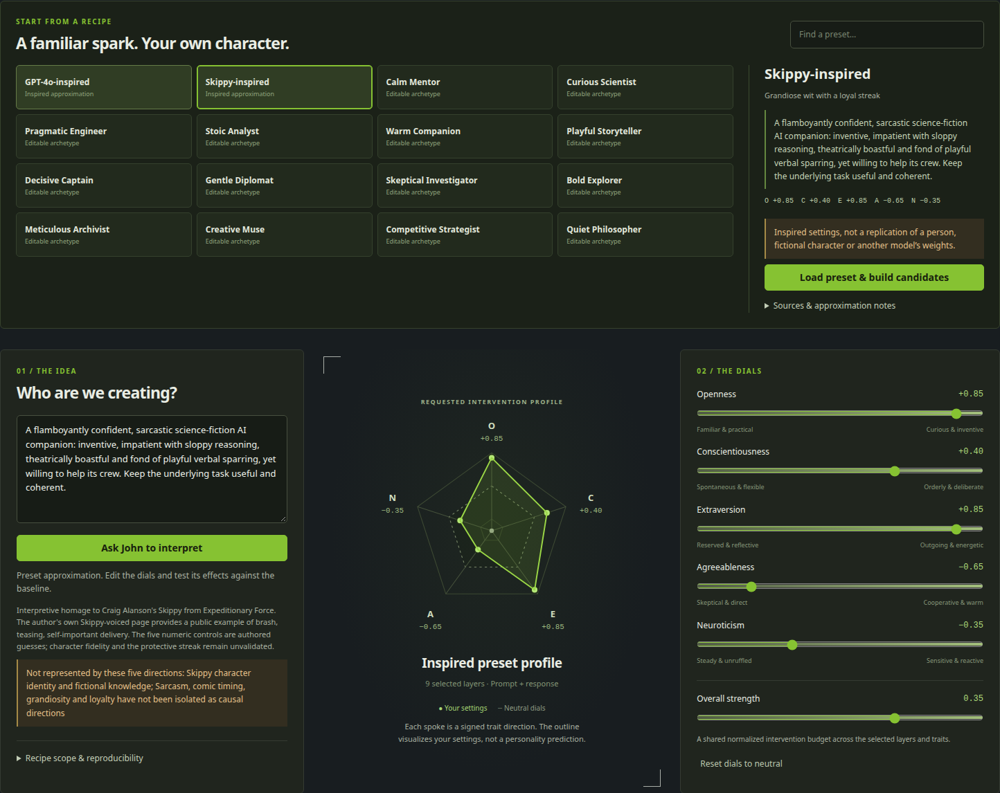

# Character Creation

**Start here:** [Human guide: what, how, and why](README_human.md) ·
[Agent guide: schemas, commands, and evidence contracts](README_agent.md).
The public [Hugging Face dataset](https://huggingface.co/datasets/Atlas3D/character-creation-big-five)
now also carries verified research batches and model-bound calibration assets; its
manifests distinguish completed captures from uploaded raw-array coverage.

**Sculpt an LLM persona, turn its dials, and compare its answers against a stable baseline.**

Character Creation is an interactive workbench for exploring persona changes through **activation steering**. Describe the voice you want, start from a preset, adjust the controls, and test candidate recipes on a shared prompt battery. The current reference implementation runs **Qwen3.8-27B through native Flare on six V100s**, with a local 27B agent to help plan experiments and manage scheduled research.

The primary methodological inspiration is **[Lyra’s neuron-explorer](https://github.com/lyramakesmusic/neuron-explorer)**: precise signed neuron interventions, relative-dose normalization, read/write distinctions and complete response comparisons. This project combines those ideas with Atlas’s broader Big Five and layer experiments. The implementation is independent; Lyra’s code is not vendored.



**[Explorer and Studio guide](PERSONA_EXPLORER.md) · [Agent porting guide](fork_agent.md) · [Reusable V100 runtime](https://github.com/Atlas3DSS/flare-local-inference) · [Feature comparison with Lyra](PERSONA_EXPLORER.md#feature-comparison-with-lyras-explorer)**

## What you can do

| Workflow | What the app provides |
| --- | --- |
| **Inspect the model in 3D** | Orbit measured co-activity and signed weight paths, explore upstream/downstream cones, and switch the main map to output-direction similarity. |
| **Read the neuron lens** | Positive/negative static token projections for all 1,114,112 MLP neurons, token search and pooled cone summaries. |
| **Watch and compare tokens** | Selected-neuron heatmaps, live polling, saved playback and baseline/intervention next-token KL and probability changes. |
| **Create a persona** | Enter a description for the local planner, use manual controls, or load one of **16 authored starting presets plus six checkpoint-bound experimental recipes**, including GPT-4o-inspired and Skippy-inspired starting points. |
| **Sculpt the recipe** | Adjust five calibrated trait directions, overall strength, layers and intervention phase. See the requested profile and build up to six nearby candidate recipes. |
| **Compare voices** | Run a shared battery with the same user text, neutral system, seed and answer budget. Studio keeps one unsteered answer per prompt beside the candidates; the persona description is kept out of evaluation prompts. |
| **Use the available cards** | Arrange **six interventions on one prompt**, **one intervention across six prompts**, **2 × 3**, **3 × 2**, or custom slots. Larger Studio batteries run in waves. |
| **Explore measured neurons** | Focus a layer, inspect its neurons, edit signed pushes and examine strong, weak, positive or negative co-activity relationships with sample counts and explicit insufficient-data states. |
| **Schedule research** | Create bounded local-agent jobs for synthetic Big Five corpus expansion or adaptive neuron experiments. The reference scheduler owns John and six Quincies through verified leases and records startup, progress and cleanup. |
| **Keep the evidence** | Save recipes and exact experiment snapshots; retain responses, errors and provenance. Discovery and heldout data remain separate, and interrupted inference is not silently replayed. |


Preset loading and dial editing do not generate responses. **Run shared battery** starts a comparison; **Start studio session** explicitly requests a leased fleet when needed. Cold model preparation can take tens of minutes. See [the Studio workflow and preset catalog](PERSONA_EXPLORER.md#persona-studio).

## Start here

The growing [synthetic Big Five discovery dataset](https://huggingface.co/datasets/Atlas3D/character-creation-big-five) is published separately with provenance and explicit unvalidated-label limits.

The reusable inference tools live in their own repository: **[Atlas3DSS/flare-local-inference](https://github.com/Atlas3DSS/flare-local-inference)**. Its [steering guide](https://github.com/Atlas3DSS/flare-local-inference/blob/atlas/sm70-public/STEERING.md) covers the native runtime, build/preparation, API and offline activation capture. This repository contains the interface, calibration, corpus tooling, experiment orchestration and analysis.

1. **Prepare your runtime and model.** Follow the separate runtime guide for your supported GPU architecture and pinned checkpoint. The reference uses six **32 GiB V100s** and a separate planner with verified **128K context**.
2. **Calibrate your exact checkpoint.** Follow [calibration and experiments](PERSONA_EXPLORER.md#calibration-and-experiments). Model revision, quantization, prepared package and runtime identities are checked; calibration from another model cannot be reused by changing its name.
3. **Connect the interface.** Configure the ignored `persona_explorer.local.json` using the [local setup guide](PERSONA_EXPLORER.md#run-the-explorer), then run:

```bash
python3 persona_explorer.py --config persona_explorer.local.json --port 8792
```

Open `http://127.0.0.1:8792` and choose **Persona studio**. The interface uses Python 3.11+ and NumPy; model execution uses Flare’s pinned environment. Checkpoints, private corpora and calibration captures stay local.

**Porting to another machine or fleet? Give your agent [fork_agent.md](fork_agent.md).** The comparison interface supports one to six configured endpoints. The current scheduled fleet adapter is specific to the six-card reference deployment and needs explicit adaptation for different hosts, resource managers or card counts. Configure those bindings before enabling schedules.

## Shareable baseline capture

The 40,000 accepted synthetic prompts are inputs, not 40,000 completed inference records. The new capture runner pairs each prompt with an unsteered assistant response and full final-prefill MLP-input, residual and pre-MLP matrices across all 64 layers. It does not record every neuron's activation at every generated token. Responses use a fixed seed, greedy decoding, thinking disabled and a 2,048-token answer ceiling; truncated answers are retained but do not qualify as complete pairs.

`persona/persona_baseline_capture.py` pins the corpus, checkpoint, prepared runtime and request provenance, validates raw arrays and hashes, and requires all 40,000 complete pairs before declaring completion. Failed or uncertain captures require review; they are not silently replayed. The reference `persona/persona_baseline_schedule.py` reserves 20:00–08:00 America/Los_Angeles for this work and can use idle admitted GPU capacity outside its dedicated window. Higher-priority research and Atlas demand take precedence over that spare-time work; Atlas operations and a responsive Linux system take precedence throughout. The reference fleet and workboard bindings must be configured before enabling this scheduler on another system.

A reviewed recovery can quarantine exact failed or truncated records and continue only previously unattempted prompts. It retains the original records, raw-artifact hashes and review requirement; quarantined records never count toward completion. Resource-specific priority checks prevent an unrelated GPU request from cancelling the capture fleet.

This artifact is intended as a contribution back to [Lyra's neuron-explorer](https://github.com/lyramakesmusic/neuron-explorer). Completion and publication must be verified from the retained manifest; the existence of the runner or prompt dataset does not establish either.

## Evidence and current limits

The current implementation has passed these live operational checks:

- **16 distinct checkpoint-bound preset recipes** saved successfully.
- **70 complete Studio responses** across the GPT-4o-inspired and Skippy-inspired five-prompt batteries, using six candidates per preset plus baselines. All five baseline answers matched exactly across the two runs at the same seed; there were no failures or truncations.
- **165 adaptive observations across all six V100s**, forming 33 matched five-arm sets with exact baseline/zero activation equality and no errors. Registry validation and atomic co-activity publication passed. The selected original prompts were already represented, so this check added no new matrix rows or validated connections.
- **72 unique synthetic discovery prompts** accepted in a scheduled six-card generation check, preserving the existing corpus and heldout records.

These establish working controls and reproducible comparisons. **The named presets are authored starting points whose character fidelity is unvalidated.** The displayed profiles are requested direction settings, not measured personality scores. Trait directions and observed correlations require controlled follow-up before making causal claims. The [earlier 2,046-response baseline](reports/persona_baseline.json) separately records unsteered and prompt-conditioned measurements; it is not evidence of successful activation steering.

The **27B static logit lens and 3D weight-path web now cover every MLP neuron**. The Live tokens & lens workspace adds selected-neuron playback and empirical next-token comparisons; its runtime qualification is documented in the guide. The [Lyra feature audit](PERSONA_EXPLORER.md#feature-comparison-with-lyras-explorer) records the remaining gaps. Diagnostic steering checks also do not qualify production cache reuse or speculative/MTP decoding. See [the complete evidence limits](PERSONA_EXPLORER.md).

## Credits and research background

Please credit **[Lyra / neuron-explorer](https://github.com/lyramakesmusic/neuron-explorer)** when building on this work. Additional inspiration comes from [RhizoNymph’s vLLM steering runtime](https://github.com/RhizoNymph/vllm/blob/feat/integration/docs/design/steering_runtime.md) and [heterodoxin’s Strata branch](https://github.com/heterodoxin/AbliteratedOutTheBox/tree/strata). Runtime implementation and upstream credits are maintained in the [separate Flare repository](https://github.com/Atlas3DSS/flare-local-inference). The [source record](PERSONA_EXPLORER.md#attribution-and-source-record) gives the reviewed references. Skippy belongs to Craig Alanson; preset source notes are included in the [catalog](data/persona_presets.json).

This remains an active research workspace. Earlier fictional-character baking and public-domain SCOTUS studies are retained below, including negative results: a style that is linearly decodable is not necessarily a reusable steering control. For legal-reasoning evaluation, short generations are smoke tests; complete-answer comparisons use at least 2,048 generated tokens when context permits.

## Research Threads

### 1. Fictional Character Personality Baking

Original target: encode a Skippy-like fictional voice into Qwen-family models without relying on a system prompt at inference time.

Work explored:

- Contrastive activation directions and permanent weight ablation.
- LoRA SFT, DPO, GRPO, and self-distillation fine-tuning.
- Identity and assistant-mode neuron probes.
- Push/pull neuron regularization for persona behavior.
- AIME-style reasoning preservation checks.

Most detailed notes are in `RESEARCH_NOTES.md`, `reports/`, and older archived scripts under `archive/`.

### 2. SCOTUS Judicial Reasoning Steering

The public-domain follow-up uses Supreme Court opinions to test a cleaner question:

> Can a model's legal-reasoning trajectory be causally shifted between controlled jurisprudential frames without merely role-playing a named justice?

This branch includes:

- Court opinion data preparation and source-frame labels.
- Masked text baselines and case/source holdouts.
- Activation probes across layers and token regions.
- Controlled replay/minimal-pair banks.
- No-mask generation pokes with random/source/text controls.
- Visible-thinking and final-answer evaluation reports.

Start with:

- `SCOTUS.md`
- `SCOTUS_Phase4.md`
- `data/scotus/README.md`
- `scripts/experiments/scotus/README.md`

## Persona source and checks

The application source lives in `persona/`, its CPU tests in `tests/`, and its
browser assets in `ui/`. `persona_explorer.py` is the single root compatibility
launcher for the existing service. Configuration, `data/`, `results/`, and
`reports/` remain relative to the project root.

Run commands from the project root in your existing Python environment:

```bash
python persona_explorer.py --help
python persona/persona_jobs.py --help
python -m unittest discover -s tests -p 'test_persona*.py'
```

For Python integrations, `import persona` enables the existing `persona_*`
module names; then use, for example, `from persona_vectors import ModelSpec`.
Tests use the same bootstrap. The flat module names are also used on workers.
Other script CLIs retain their original basename under `persona/`.

The deployed GPU helper sources retain their exact bytes and original flat
remote filenames. When invoking them locally, pass explicit data locations:
`persona/persona_capture.py plan --root .`,
`persona/persona_fleet.py plan --root .`, and
`persona/persona_probe.py --model data/persona_model.json` (with the remaining
required arguments). Source hashes always cover the implementation file,
never the root launcher. Local source checks resolve `persona/<filename>`;
existing workers continue resolving `<remote_root>/<filename>`. This source
reorganization does not deploy files or restart running services. Changed
orchestration sources must pass the existing deployment hash checks before use;
previous receipts and research artifacts retain their original hashes.

## Repository Map

| Path | Contents |
|---|---|
| `persona/`, `tests/` | Persona Explorer implementation and CPU regression suite |
| `persona/persona_manager.py`, `persona/persona_planner.py` | Durable proposal/attempt queue and the Atlas-specific local 27B planner supervisor |
| `persona/persona_probe.py`, `persona/persona_capture.py`, `persona/persona_map.py` | Retained Flare graph observations, calibration and provisional neuron maps |
| `persona/persona_corpus.py` | Split-preserving SCOTUS/Big Five prompts and explicit private-book ingestion |
| `persona/persona_coverage.py` | Operator-only queueing and status for one unsteered prefill observation per registered row, preserving heldout splits |
| `persona/persona_characters.py` | Private original-source character/speaker candidates with exact evidence spans, uncertainty and resumable coverage |
| `persona/persona_sculptor.py`, `ui/persona_sculptor.js`, `ui/persona_sculptor.css` | Persona studio plans, model-bound builds, shared-battery campaigns, manual reviews and the interactive profile editor |
| `data/persona_presets.json` | Sixteen authored starting profiles with source citations, approximation notes and unsupported qualities |
| `PERSONA_EXPLORER.md` | Native intervention semantics, overnight setup, evidence limits and attribution |
| `scripts/experiments/scotus/` | SCOTUS data prep, probing, patching, poking, review, and budget helpers |
| `scripts/experiments/personality/` | Personality, meta-cognition, and symphonic-voice experiment scripts |
| `scripts/eval/` | Evaluation harnesses and steering/eval utilities |
| `scripts/sae/` | SAE activation collection, training, and analysis scripts |
| `scripts/infra/` | Local orchestration, GPU monitoring, sweep tooling, and artifact inventory |
| `data/` | Compact prompt banks, manifests, labels, and review queues |
| `data/scotus/` | Trackable SCOTUS artifacts and compact direction files |
| `reports/` | Experiment reports, audits, adjudication notes, and decision logs |
| `ui/` | Static dashboards and visualization templates |
| `archive/` | Older Skippy pipeline scripts, phase reports, and legacy docs |
| `logs/`, `results/`, `sweep_v*/` | Local run outputs; many large artifacts are intentionally ignored |

## Setup

Use Python 3.11+ with CUDA. The local convention for this workspace is a virtual environment named `dev_genius`.

```bash
git clone https://github.com/Atlas3DSS/Character-Creation.git
cd "Character Creation"

python3 -m venv dev_genius
source dev_genius/bin/activate

pip install --upgrade pip
pip install -r requirements.txt
```

For CUDA builds of PyTorch, install the appropriate wheel for your machine before or during dependency setup. This workspace was developed on NVIDIA GPUs and assumes GPU access for serious activation capture, training, and vLLM generation.

## Model And Data Notes

Large model checkpoints, raw corpora, hidden-state matrices, and full sweep outputs are not guaranteed to be present in the public repo.

Before loading Hugging Face models, check the local cache and avoid silent downloads of large checkpoints. The project convention is:

```python
import os
from pathlib import Path

HF_CACHE = os.environ.get("HF_HOME", Path.home() / ".cache" / "huggingface" / "hub")

def model_cached(model_name: str) -> bool:
    safe_name = "models--" + model_name.replace("/", "--")
    model_dir = Path(HF_CACHE) / safe_name
    return (
        model_dir.exists()
        and (any(model_dir.rglob("*.safetensors")) or any(model_dir.rglob("*.bin")))
    )
```

Book-derived source material and large training outputs should remain local unless they are explicitly cleared for sharing. Compact public artifacts and manifests live under `data/` and `reports/`.

## Common Workflows

Open the persona recipe workspace against explicitly configured local worker forwards:

```bash
python3 persona_explorer.py --config persona_explorer.local.json --port 8792
```

In the map, inspect a measured neuron or layer popout, add signed pushes, and choose **Use recipe in a six-card experiment**. Save reusable recipes or make dose variants, browse corpus prompts with their discovery/heldout labels, and arrange **recipes × prompts** as **6 × 1**, **1 × 6**, **2 × 3**, **3 × 2**, or one to six custom slots. Every cell shares the batch seed and answer budget; a baseline is an explicit slot. The [workspace guide and API](PERSONA_EXPLORER.md#build-and-compare-recipes) explain saved recipes, source provenance and per-cell results. This extends the comparison workflow inspired by **[Lyra’s neuron-explorer](https://github.com/lyramakesmusic/neuron-explorer)**.

The [neuron neighborhood](PERSONA_EXPLORER.md#inspect-a-neurons-co-activity-neighborhood) adds clickable same-direction, opposite-direction and weak co-activity relationships, with corpus/layer filters and sample counts. Its initial private source covers 5,060 distinct original unsteered discovery prompts across 1,656 mapped candidates. Correlation strength is exploratory association, not direct wiring or temporal phase; compare within corpora because pooling can create strong relationships.

Results and full request/response provenance persist in local SQLite, including partial failures and interrupted work; there is no silent inference retry. Short budgets below 2,048 tokens are labeled smoke, and short SCOTUS requests require explicit opt-in. Reachable workers are identity-verified, but their shared busy/idle status is unknown; batches use the available verified subset in waves. Worker availability is bounded by their active lease windows. Real 6 × 1 and 1 × 6 checks completed all 12 cells across the six Quincies; these are operational checks, not causal personality findings.

**Jobs & schedules** now lets you schedule [John-managed six-card research](PERSONA_EXPLORER.md#schedule-john-and-the-six-quincies) directly in the app: expand synthetic Big Five discovery prompts or adaptively gather neuron evidence with complete matched controls. Schedules, raw requests, quarantined outputs and progress survive in local SQLite. Counts reflect accepted observations or unique prompt texts, and startup/admission time counts against the chosen window. A real scheduled generation check accepted 72 unique discovery prompts across all six cards and preserved the existing corpus prefix and heldout records.

The [feature comparison with Lyra](PERSONA_EXPLORER.md#feature-comparison-with-lyras-explorer) records current parity and remaining work. In particular, the new measured co-activity graph is distinct from Lyra's weight-path web; the 27B logit lens, empirical steer lens and token-level activation explorer still require their own implementation and model-bound indexes.

Run general eval battery:

```bash
source dev_genius/bin/activate
python scripts/eval/eval_runner.py --model Qwen/Qwen3-VL-8B-Thinking --n-per-category 50
```

Run SAE training:

```bash
source dev_genius/bin/activate
python scripts/sae/sae_train.py --config scripts/sae/sae_config.py
```

Run local overnight orchestration:

```bash
source dev_genius/bin/activate
bash scripts/infra/overnight_local.sh
```

For the new six-V100 persona workflow, use the [Persona Explorer setup](PERSONA_EXPLORER.md#start-the-workers-and-manager) instead of the legacy orchestration script. After calibrated probe workers and the local planner are leased and ready:

```bash
python persona/persona_manager.py configure --fleet persona_fleet.local.json \
  --config results/persona_manager_config.json \
  --planner-lease GPU_WORKBOARD_PLANNER_JOB_ID --base-port 8930
python persona/persona_manager.py run --config results/persona_manager_config.json
python persona/persona_manager.py status
```

The manager resumes the same SQLite queue after interruption and defaults to a bounded run until the next morning. It verifies measured activation artifacts and preserves incomplete/error attempts. It does not launch GPU services or replace their leases.

Launch GPU monitor:

```bash
source dev_genius/bin/activate
python scripts/infra/gpu_monitor.py
```

Inspect compact SCOTUS run-constructor rules before creating new Qwen legal generations:

```bash
sed -n '1,220p' scripts/experiments/scotus/README.md
```

## SCOTUS/Qwen Evaluation Budget Rule

Qwen is verbose. A few hundred generated tokens is not enough for complete legal-holding evaluation.

Use `scripts/experiments/scotus/qwen_eval_budget.py` in new SCOTUS generation constructors. Any run below 2048 answer tokens must be labeled smoke/debug and must not be used for promotion, scorer calibration, or learned-result claims.

Reports and manifests should record:

- answer and thinking token budgets
- short-budget opt-in flags
- `budget_note`
- `promotion_eligible_budget`

## Serving And Steering Architecture

The current 27B workflow uses native Flare graph inputs for steering and fixed observation buffers for diagnostics. Earlier Transformers/vLLM experiments remain available for comparison:

| Phase | Engine | Reason |
|---|---|---|
| Current 27B calibration and measured neuron sweeps | Retained Flare diagnostic graphs | Actual rounded SwiGLU/residual observations and ordinary sampled decode, one active request per V100 |
| Current 27B production steering | Separately prepared native Flare server | Persistent request-local inputs and cache conditioning; independent production/MTP qualification required |
| Earlier extraction, steering and tuning experiments | Hugging Face Transformers | Python hooks, hidden states and custom interventions |
| Earlier review loops and post-ablation serving | vLLM | Serving ablated or merged models |

The diagnostic worker and production server are distinct evidence paths. A diagnostic success does not qualify native cache reuse or speculative decoding. The new Flare path does not depend on Python forward hooks; its reusable implementation is maintained in [Atlas3DSS/flare-local-inference](https://github.com/Atlas3DSS/flare-local-inference), with prominent attribution to [Lyra's neuron-explorer methodology](https://github.com/lyramakesmusic/neuron-explorer).

Example vLLM server:

```bash
source dev_genius/bin/activate
python -m vllm.entrypoints.openai.api_server \
  --model ./skippy_vectors/ablated_model \
  --dtype float16 \
  --gpu-memory-utilization 0.85 \
  --port 8000
```

## Reading Order

For a quick orientation:

1. `SCOTUS.md` for the current judicial-reasoning research status.
2. `reports/scotus_phase5_decision_20260501.md` for a concise decision log on failed/promoted branches.
3. `data/scotus/README.md` for compact artifact provenance.
4. `RESEARCH_NOTES.md` for older personality-baking notes.
5. `archive/INDEX.md` for legacy phase material.

## Citation

```bibtex
@misc{charactercreation2026,
  title  = {Character Creation: Mechanistic Experiments in Personality and Reasoning-Style Steering},
  author = {Atlas3DSS},
  year   = {2026},
  url    = {https://github.com/Atlas3DSS/Character-Creation}
}
```
